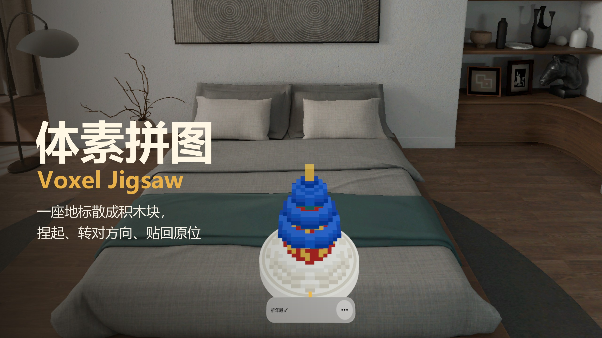
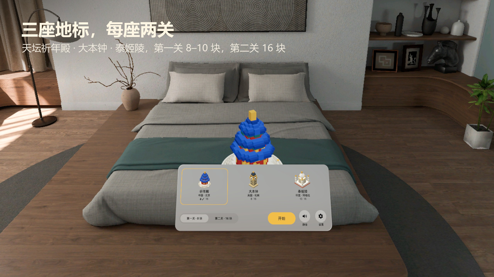
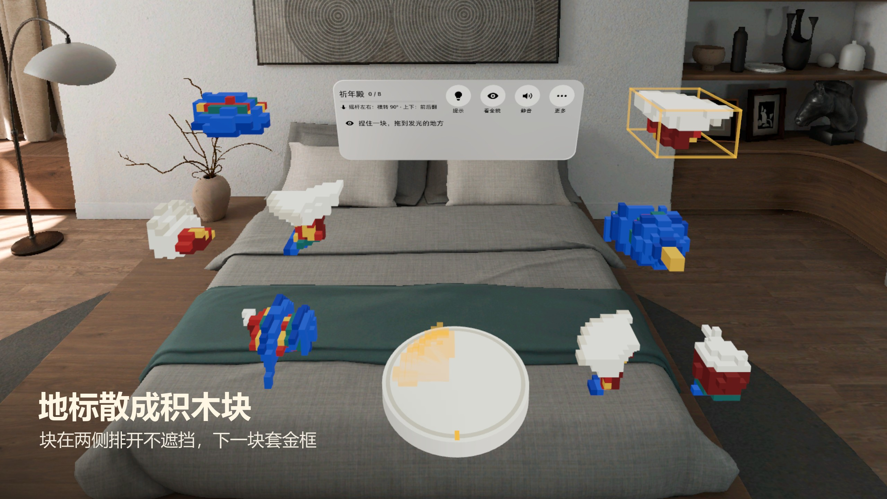
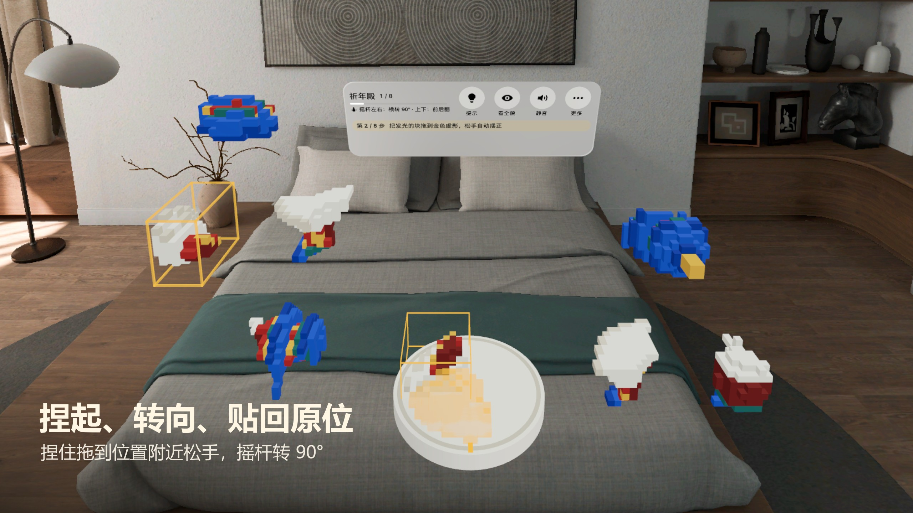
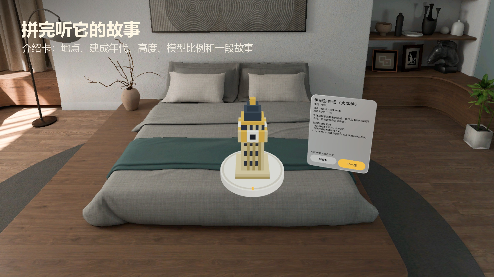
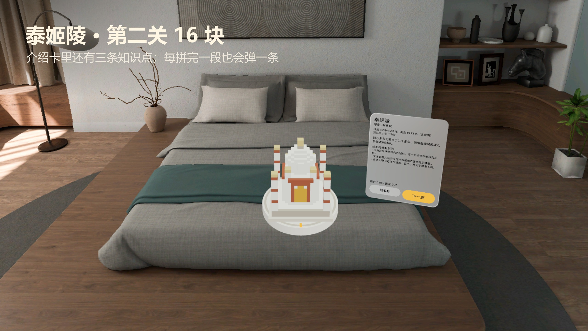
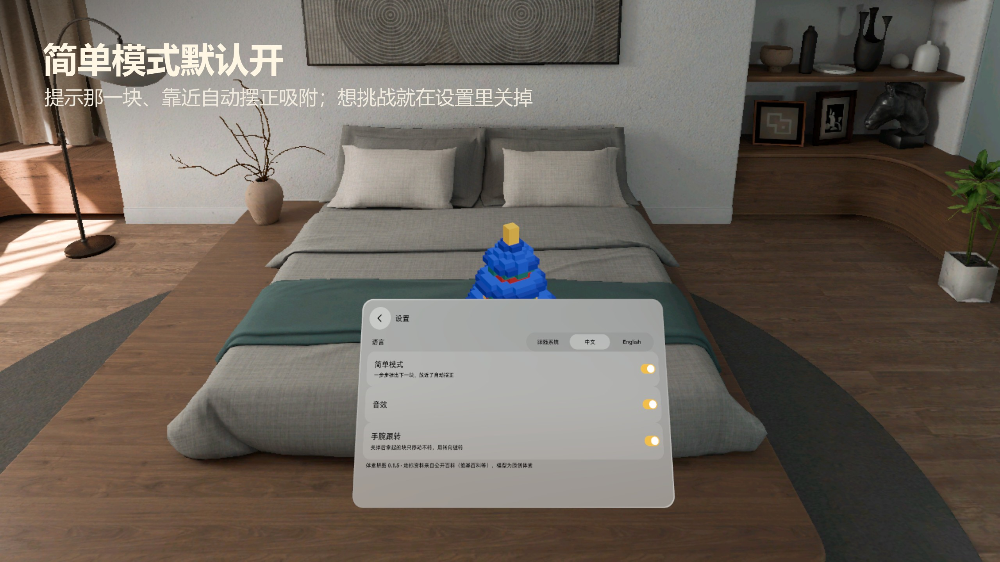

# 体素拼图 Voxel Jigsaw



一座世界地标在你面前的转台上散成体素积木块。捏起一块，转对方向，贴回原来的位置；一块一块拼回去，整座建筑就立起来了，最后听它的故事。PICO OS 6 空间应用（PICO Spatial SDK 6.1，Kotlin，共享空间体积窗口）。

A world landmark falls apart into voxel blocks on a turntable in front of you. Pinch a block, turn it the right way, put it back where it belongs; piece by piece the building stands up again, then it tells you its story. A PICO OS 6 spatial app (PICO Spatial SDK 6.1, Kotlin, a volume in the Shared Space).

## 截图 Screenshots


首页：三座地标、两关、带字的静音和设置键 · Home: three landmarks, two levels, labelled mute and settings keys


开局：块在两侧排开，下一块套金框 · Start: pieces laid out on both wings, the next one framed in gold


捏起一块拖到转台上 · Holding a piece over the turntable


大本钟拼完，介绍卡 · Big Ben finished, story card


泰姬陵第二关 16 块拼完 · Taj Mahal level 2 (16 pieces) finished


设置：语言、简单模式、音效、手腕跟转 · Settings: language, easy mode, sound, wrist follow


截图来自 PICO 模拟器 6.1（高清画质），由调试广播驱动，**非真实手势录像**。
Screenshots are from the PICO 6.1 emulator (High Definition), driven by debug broadcasts — **not a recording of real hand input**.

## 玩法 How it plays

- **三座地标，每座两关**：天坛祈年殿、伊丽莎白塔（大本钟）、泰姬陵；第一关 8–10 块，第二关 16 块。
  **Three landmarks, two levels each**: Hall of Prayer for Good Harvests, Elizabeth Tower (Big Ben), Taj Mahal; level 1 has 8–10 pieces, level 2 has 16.
- **捏起、转向、贴回**：眼看 + 捏合选块，捏住拖到位置附近松手；转向键或手柄摇杆（左右转 90°、上下翻 90°）。
  **Pinch, turn, place**: look and pinch to select, drag near its place and let go; turn with the keys or the thumbstick (left/right turns 90°, up/down tips 90°).
- **转台**：拖转台边缘，整座模型停在 90° 的档位。 **Turntable**: drag the rim to turn the model to 90° stops.
- **知识点与介绍卡**：每拼完一段弹一条知识点，拼完出地点、年代、高度、比例和故事。
  **Facts and a story card**: each finished section shows a fact; the finished landmark shows where, when, how tall, the model scale and its story.
- **简单模式（默认开）**：常驻「第 n 步」，下一块金框呼吸 + 原位金色虚影；点「提示」那一块跳一下并选中；4 cm 内松手自动摆正吸附。设置里可关。
  **Easy mode (on by default)**: a step line, a breathing gold frame on the next piece and its gold ghost in place; Hint bobs and selects it; a piece let go within 4 cm turns itself and snaps in. Off in Settings.
- **看全貌**开关、带字的静音键、进度自动保存、中英双语、不联网不需要账号。
  **Peek** toggle, labelled mute key, progress saved, Chinese and English, offline, no account.

## 安装 Install

```bash
adb install -r VoxelJigsaw-v0.1.5.apk
pico-cli app launch io.embodit.voxeljigsaw
```

APK 在 [Releases](https://github.com/kejing-dev/VoxelJigsaw/releases)。 The APK is attached to each [release](https://github.com/kejing-dev/VoxelJigsaw/releases).

## 构建 Build

```bash
./gradlew assembleDebug          # JDK 21; PICO Spatial SDK 6.1
./gradlew testDebugUnitTest
node tools/bake/bake_puzzles.js  # only when the puzzle cuts change
```

开发说明（调试广播、截图脚本、已知限制）见 [AGENTS.md](AGENTS.md)。 Developer notes (debug broadcast, screenshot tour, known limits) are in [AGENTS.md](AGENTS.md).

## 已知限制 Known limits

- 手柄摇杆在模拟器上没有数据（`ControllerTrackingProvider` 只在 Full Space 有），共享空间里用窗口滚动事件兜底；真机方向待确认。
  The thumbstick has no data on the emulator (`ControllerTrackingProvider` is Full Space only); a window scroll fallback is used in the Shared Space, its direction on a headset is still to confirm.
- 音效用 SoundPool，不是空间音频。 Sounds use SoundPool, not spatial audio.

## 素材来源 Credits

- 地标造型由 `tools/bake/vj-core.js` 程序生成；知识点文字参考维基百科（[Temple of Heaven](https://en.wikipedia.org/wiki/Temple_of_Heaven)、[祈年殿](https://zh.wikipedia.org/wiki/祈年殿)、[Big Ben](https://en.wikipedia.org/wiki/Big_Ben)、[Taj Mahal](https://en.wikipedia.org/wiki/Taj_Mahal)）。
  Landmark models are generated by `tools/bake/vj-core.js`; the facts are written from Wikipedia.
- 设置图标：Google Material Icons「settings」，Apache-2.0。 Settings icon: Google Material Icons "settings", Apache-2.0.
- 音效由 `tools/make_sounds.py` 合成。 Sounds are synthesised by `tools/make_sounds.py`.
